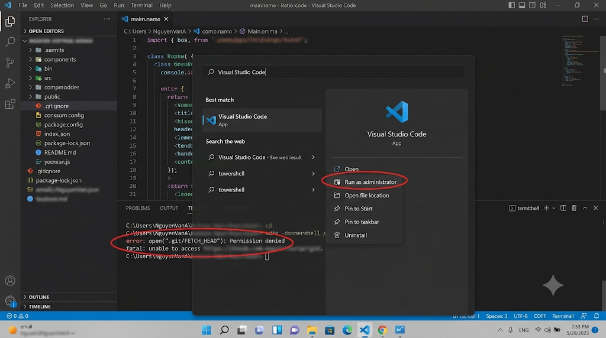

### Prompt AI (Công thức 3 thành phần)

"Đóng vai bạn bè rành IT. Giải thích lỗi error: open(".git/FETCH_HEAD"): Permission denied và cách sửa. Viết bình dân, ngắn gọn trong 3 câu, không dùng từ ngữ học thuật."

### Thao tác & Chụp ảnh minh họa

Thực hiện: Mở menu Start -> Chuột phải vào Visual Studio Code (hoặc PowerShell) -> Run as Administrator.

Quy chuẩn ảnh:

Khoanh vùng: Nút Run as administrator và dòng lỗi Permission denied trên Terminal.

Bảo mật: Làm mờ đường dẫn chứa thông tin cá nhân và các API keys.

### Mẫu Bug Report (Gửi giảng viên)

Tiêu đề: [Hỗ trợ] Lỗi Permission denied khi push code GitHub

Lỗi thực tế (Actual): Nhận thông báo error: open(".git/FETCH_HEAD"): Permission denied.

Kết quả mong đợi (Expected): Lệnh chạy thành công, code lên GitHub.

Bước tái hiện (Steps): Mở Terminal trong thư mục code -> Chạy git push origin main -> Xuất hiện lỗi.

Cách đã thử (Attempts): Đã tắt và mở lại bằng quyền quản trị viên nhưng vẫn văng mã lỗi cũ.

Môi trường (Env): Windows 11, VS Code, PowerShell.